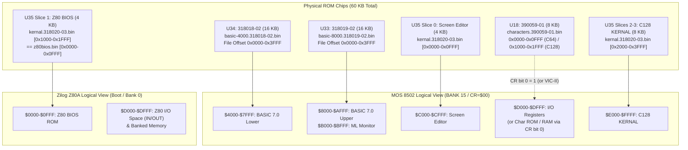

# PHASE 1 DELIVERABLE 1.3: ROM SEGMENTATION AND MEMORY LAYOUT

**Project:** `cbm-128-core`  
**Target:** Commodore 128 Original 1985 Firmware Set  
**Investigation Phase:** Phase 1 — ROM Forensics and Identification  
**Evidence Location:** [`REA/EVIDENCE/PHASE1/segmentation_analysis.json`](file:///D:/Emulation/C128/REA/EVIDENCE/PHASE1/segmentation_analysis.json), [`REA/EVIDENCE/PHASE1/basic_tables_exact.json`](file:///D:/Emulation/C128/REA/EVIDENCE/PHASE1/basic_tables_exact.json)

---

## 1. Physical vs. Logical Address Mapping & MMU Bank Topologies

The Commodore 128 employs the **MOS 8722 Memory Management Unit (MMU)** together with the **8721 PLA** to map a 64 KB logical CPU address space across two 64 KB DRAM banks (Bank 0 and Bank 1), 48 KB of C128 system ROMs (`U34`, `U33`, `U35`), 8 KB of Character ROM (`U18`), and memory-mapped I/O (`$D000-$DFFF`).

### 1.1 MMU Configuration Register (`$FF00` / `$D500`) Bit Decoding
- **Bits 7–6 (`BANK`):** Select Physical RAM Bank (`00` = RAM Bank 0, `01` = RAM Bank 1).
- **Bits 5–4 (`HI` — `$C000-$FFFF`):** `00` = System ROM (`U35`: Editor `$C000-$CFFF` + KERNAL `$E000-$FFFF`), `01` = Internal Function ROM, `10` = External Function ROM, `11` = RAM.
- **Bits 3–2 (`MID` — `$8000-$BFFF`):** `00` = System ROM (`U33`: BASIC 7.0 Upper + ML Monitor), `01` = Internal Function ROM, `10` = External Function ROM, `11` = RAM.
- **Bit 1 (`LO` — `$4000-$7FFF`):** `0` = System ROM (`U34`: BASIC 7.0 Lower), `1` = RAM.
- **Bit 0 (`IO` — `$D000-$DFFF`):** `0` = I/O Devices (`$D000-$DFFF`: VIC-IIe, SID, VDC, MMU, CIA1, CIA2), `1` = ROM/RAM according to `HI` bits (when `HI = 00` and `IO = 1`, Character Generator ROM `U18` upper 4 KB `0x1000–0x1FFF` appears at CPU `$D000-$DFFF`).
- **Always-Visible MMU Load/Config Registers (`$FF00-$FF04`):** Mapped across **all** banks and memory configurations at `$FF00-$FF04`, shadowing the 5 bytes of KERNAL ROM at file offsets `0x3F00–0x3F04` (`FF FF FF FF FF`).

---

## 2. Internal Segmentation of `basic-4000.318018-02.bin` (`$4000-$7FFF`)

**Finding ID:** `C128-BASIC-001` (**CONFIRMED**)

| File Offset | CPU Address | Size (Bytes) | Subsystem / Structural Segment | Verification Evidence |
|---|---|---:|---|---|
| `0x0000–0x0008` | `$4000–$4008` | 9 | **BASIC 7.0 Entry Jump Vectors** | `$4000: JMP $4023` (Cold Start), `$4003: JMP $4009` (Warm Start / IRQ init), `$4006: JMP $A84D` (Cross-ROM entry into Upper BASIC) |
| `0x0009–0x01BB` | `$4009–$41BB` | 435 | **BASIC Cold/Warm Initialization & Zero-Page/Bank Setup** | Initializes MMU/BASIC pointers, CHRGET routine copy, bank vectors, and startup state |
| `0x01BC–0x024F` | `$41BC–$424F` | 148 | **Startup Sign-On Banner & Copyright Text** | `\r@ COMMODORE BASIC V7.0 122365 BYTES FREE\r@ (C)1985 COMMODORE ELECTRONICS, LTD.\r@ (C)1977 MICROSOFT CORP.\r@ ALL RIGHTS RESERVED\r` |
| `0x0250–0x032A` | `$4250–$432A` | 219 | **Indirect Vector Init & Hardware Support Helpers** | Initializes `$0300-$0313` BASIC indirect vectors (`IERROR`, `IMAIN`, `ICRNCH`, `IQPLOP`, `IGONE`, `IEVAL`) |
| `0x032B–0x0416` | `$432B–$4416` | 236 | **Tokenizer (`CRUNCH`) Engine** | Scans input lines and converts ASCII keywords into single-byte (`$80-$FE`) and two-byte (`$CE xx`, `$FE xx`) tokens using `$4417`, `$4609`, and `$46C9` tables |
| `0x0417–0x0608` | `$4417–$4608` | 498 | **Primary Keyword Token Table (126 Tokens, `$80–$FD`)** | High-bit terminated strings from `END` (`$80`) through `WHILE` (`$FD`), terminated by `0x00` at `$4608` |
| `0x0609–0x06C8` | `$4609–$46C8` | 192 | **Extended `0xCE` Keyword Token Table (37 Tokens)** | High-bit terminated strings for `BANK`, `FILTER`, `PLAY`, `TEMPO`, `MOVSPR`, `SPRITE`, `SPRCOLOR`, `RREG`, `ENVELOPE`, `SLEEP`, `CATALOG`, `DOPEN`, `APPEND`, `DCLOSE`, `BSAVE`, `BLOAD`, `RECORD`, `CONCAT`, `DVERIFY`, `DCLEAR`, `SPRSAV`, `COLLISION`, `BEGIN`, `BEND`, `WINDOW`, `BOOT`, `WIDTH`, `SPRDEF`, `QUIT`, `STASH`, `FETCH`, `SWAP`, `OFF`, `FAST`, `SLOW`, terminated by `0x00` at `$46C8` |
| `0x06C9–0x0700` | `$46C9–$4700` | 56 | **Extended `0xFE` Function Token Table (9 Tokens)** | `POT`, `BUMP`, `PEN`, `RSPPOS`, `RSPRITE`, `RSPCOLOR`, `XOR`, `RWINDOW`, `POINTER`, followed by `00 00 00` (`$46FE-$4700`) |
| `0x0701–0x084A` | `$4701–$484A` | 330 | **Command & Operator Dispatch Address Tables** | 16-bit `(addr - 1)` RTS-dispatch vectors and operator precedence/action vectors pointing into both `$4000-$7FFF` and `$8000-$AFFF` |
| `0x084B–0x0A84` | `$484B–$4A84` | 570 | **BASIC 7.0 Error Message Tables (41 Messages)** | High-bit terminated error strings (`#1 TOO MANY FILES` at `$484B` through `#41 FILE READ` at `$4A79`) |
| `0x0A85–0x0F7F` | `$4A85–$4F7F` | 1,275 | **Error Handler, Direct Mode Loop (`READY.`), Line Linker & `LIST` Engine** | Error message lookup (`$4A85`), `READY.` loop (`$4D2D`), line insertion/deletion, and detokenizer (`QPLOP`) |
| `0x0F80–0x23F4` | `$4F80–$63F4` | 5,237 | **Core Statement Execution (`FOR`/`NEXT`, `IF`/`THEN`/`ELSE`, `DO`/`LOOP`, `GOSUB`, `INPUT`/`READ`/`PRINT`, Structured Flow)** | Main `GONE` interpreter loop, expression evaluator (`FRMNUM`/`FRMEVL`), string/array management |
| `0x23F5–0x2409` | `$63F5–$6409` | 21 | **Embedded Developer Signatures** | `FRED B\rTERRY R\rMIKE I\r` |
| `0x240A–0x3E81` | `$640A–$7E81` | 6,776 | **Graphics, Sprite Editor (`SPRDEF`), Disk/DOS Commands & C128 Extended Statements (Part 1)** | `GRAPHIC`, `SCNCLR`, `BOX`, `CIRCLE`, `DRAW`, `PAINT`, `CHAR`, `SPRDEF` (`SPRITE NUMBER?`, `COPY FROM?`), `DOPEN`/`DLOAD`/`DSAVE`/`HEADER`/`DIRECTORY` |
| `0x3E82–0x3FFD` | `$7E82–$7FFD` | 380 | **Unallocated Padding (`0xFF`)** | 380 contiguous `0xFF` bytes |
| `0x3FFE–0x3FFF` | `$7FFE–$7FFF` | 2 | **ROM Revision & Checksum Trailer** | `0x00 0x4C` |

---

## 3. Internal Segmentation of `basic-8000.318019-02.bin` (`$8000-$BFFF`)

**Finding ID:** `C128-BASIC-002` (**CONFIRMED**)

| File Offset | CPU Address | Size (Bytes) | Subsystem / Structural Segment | Verification Evidence |
|---|---|---:|---|---|
| `0x0000–0x2A6D` | `$8000–$AA6D` | 10,862 | **BASIC 7.0 Upper Statements, Floating-Point Math Package, SID `PLAY`/`SOUND` & Sprite/Interrupt Engine** | Contains FP math (`FADDT`, `FMULT`, `FDIVT`, `LOG`, `EXP`, `SIN`, `COS`, `TAN`, `ATN`, `SQR`, `RND`), string functions, `RENUMBER`, `AUTO`, `KEY`, `SLEEP`, `PLAY`/`TEMPO`/`ENVELOPE`/`FILTER` parser (note tables at `$900B+`), and cold/warm helper `$A84D` (`JMP $A84D` from `$4006`) |
| `0x2A6E–0x2E62` | `$AA6E–$AE62` | 1,013 | **Unallocated Padding Block 1 (`0xFF`)** | 1,013 contiguous `0xFF` bytes |
| `0x2E63–0x2FA7` | `$AE63–$AFA7` | 325 | **Cross-Bank Trampolines & Helper Tables** | Relocated helper tables and `JMP` thunks (`$AF03–$AFA7`) |
| `0x2FA8–0x2FFF` | `$AFA8–$AFFF` | 88 | **Unallocated Padding Block 2 (`0xFF`)** | 88 contiguous `0xFF` bytes aligning the ML Monitor to `$B000` |
| `0x3000–0x3008` | `$B000–$B008` | 9 | **Machine Language Monitor Entry Jump Table** | `$B000: JMP $B021` (`MONITOR` command entry), `$B003: JMP $B009` (`BRK` vector entry), `$B006: JMP $B0B2` (Monitor command loop) |
| `0x3009–0x3B71` | `$B009–$BB71` | 2,921 | **Machine Language Monitor (`$B000-$BB71`)** | Full 8502 assembler (`A`), disassembler (`D`), memory dump/modify (`M`, `>`), register display (`R`: `\r    PC  SR AC XR YR SP\r; `), fill/hunt/compare/transfer (`F`, `H`, `C`, `T`), bank-aware load/save/verify (`L`, `S`, `V`), base conversion (`$`, `+`, `&`, `%`), command table at `$B0E6` (`ACDFGHJMRTX@.>;$+&%LSV`), opcode mnemonic packing tables at `$B6B0-$B8FF` |
| `0x3B72–0x3FFD` | `$BB72–$BFFD` | 1,164 | **Unallocated Padding Block 3 (`0xFF`)** | 1,164 contiguous `0xFF` bytes |
| `0x3FFE–0x3FFF` | `$BFFE–$BFFF` | 2 | **ROM Revision & Checksum Trailer** | `0x00 0x3A` |

---

## 4. Internal Segmentation of `kernal.318020-03.bin` (`$C000-$FFFF`) and `z80bios.bin`

**Finding ID:** `C128-KERNAL-001` (**CONFIRMED**)

| File Offset | Logical CPU Address | Size (Bytes) | Subsystem / Structural Segment | Verification Evidence |
|---|---|---:|---|---|
| `0x0000–0x002F` | `$C000–$C02F` (8502) | 48 | **Screen Editor Jump Table (16 `JMP` Entries)** | `$C000: JMP $C07B` (`CINT`), `$C003: JMP $CC34` (`DISPLY`), `$C006: JMP $C234` (`LP2`), `$C009: JMP $C29B` (`LOOP5`), `$C00C: JMP $C72D` (`PRT`), `$C00F: JMP $CC5B` (`SCRORG`), `$C012: JMP $C55D` (`SCNKEY`), `$C015: JMP $C651` (`REPEAT`), `$C018: JMP $CC6A` (`PLOT`), `$C01B: JMP $CD57` (`CURSOR`), `$C01E: JMP $C9C1` (`ESCAPE`), `$C021: JMP $CCA2` (`KEYSET`), `$C024: JMP $C194` (`IRQ`), `$C027: JMP $CE0C` (`INIT80`), `$C02A: JMP $CD2E` (`SWAPPER`), `$C02D: JMP $CA1B` (`WINDOW`) |
| `0x0030–0x0065` | `$C030–$C065` (8502) | 54 | **Screen Editor Line Address Lookup Tables** | 40-column (`0, 40, 80, 120...`) and 80-column (`0, 80, 160...`) screen row base address tables |
| `0x0066–0x0EB1` | `$C066–$CEB1` (8502) | 3,660 | **Dual-Head Screen Editor (40-Col VIC-IIe & 80-Col 8563 VDC)** | Full windowing (`ESC` sequences `ESC A`..`ESC Z`), 40/80 column mode switching (`SWAPPER` at `$CD2E`), 8563 VDC register initialization (`INIT80` at `$CE0C` using register/value table at `$CE5C`), programmable function keys |
| `0x0EB2–0x0EF4` | `$CEB2–$CEF4` (8502) | 67 | **Default Function Key String Table** | Lengths (`$CEAA-$CEB1`) + string pool (`GRAPHIC`, `DLOAD"`, `DIRECTORY\r`, `SCNCLR\r`, `DSAVE"`, `RUN\r`, `LIST\r`, `MONITOR\r`, `D"*`, `RUN\r`, `HELP\r`) |
| `0x0EF5–0x0FFD` | `$CEF5–$CFFD` (8502) | 265 | **Screen Editor End Padding (`0xFF`)** | 265 contiguous `0xFF` bytes |
| `0x0FFE–0x0FFF` | `$CFFE–$CFFF` (8502) | 2 | **Screen Editor Revision & Checksum Trailer** | `0x00 0xC3` |
| **`0x1000–0x1FFF`** | **`$0000–$0FFF` (Z80)** *(`$D000–$DFFF` in U35)* | **4,096** | **Z80 BIOS (`z80bios.bin` Exact Embedded Image)** | Z80 reset (`$0000: LD A,$3E; LD ($FF00),A; JP $003B`), `RST 08h` (`$0008`), `RST 10h` (`$0010`), `RST 18h` (`$0018`), `RST 20h` (`$0020`), `RST 28h` (`$0028`), Date stamp at `$0030` (`"05/12/85"`), `RST 38h` (`$0038: JP $FDFD`), Z80 NMI (`$0066`), CP/M 3.0 (`CPM+.SYS`) boot loader and 8502-assisted BIOS primitives, sector interleave tables (`$0FC0-$0FFF`) |
| `0x2000–0x25FA` | `$E000–$E5FA` (8502) | 1,531 | **KERNAL Hardware Reset, MMU/RAM Init, VIC/SID/CIA Setup & IEC Serial Bus Driver** | `RESTOR` (`$E056`), `VECTOR` (`$E05B`), `RAMTAS` (`$E093`), `IOINIT` (`$E109`), Reset continuation (`$E000`), Z80/8502 handoff stub copied to `$FFD0`, IEC serial bus (`TALK`, `LISTEN`, `SECOND`, `TKSA`, `CIOUT`, `UNTLK`, `UNLSN`, `ACPTR`) including C128 fast serial (`FAST` burst protocol) |
| `0x25FB–0x36AC` | `$E5FB–$F6AC` (8502) | 4,274 | **KERNAL RS-232, Cassette, Channel I/O (`OPEN`, `CLOSE`, `CHKIN`, `CHKOUT`, `BASIN`, `BSOUT`, `GETIN`), `LOAD` & `SAVE`** | Full device-independent I/O dispatcher, tape read/write waveforms, serial/burst file `LOAD` (`$F265`) and `SAVE` (`$F53E`), real-time jiffy clock (`UDTIM`, `RDTIM`, `SETTIM`) |
| `0x36AD–0x3718` | `$F6AD–$F718` (8502) | 108 | **KERNAL Status Messages** | `\rI/O ERROR `, `\rSEARCHING`, `\rPRESS PLAY ON TAPE`, `PRESS RECORD & PLAY ON TAPE`, `\rLOADING`, `\rSAVING`, `\rVERIFYING`, `\rFOUND` |
| `0x3719–0x38FF` | `$F719–$F8FF` (8502) | 487 | **KERNAL Extended C128 Services (`SETBNK`, `INDFET`, `INDSTA`, `INDCMP`, `JSRFAR`, `JMPFAR`, `PRIMM`, `BOOT`, `PHOENIX`)** | Cross-bank memory access routines (`FETCH`, `STASH`, `CMPARE`), far call/jump helpers (`$FF6E`/`$FF71` -> `$02CD`/`$02E3`), cartridge poll (`PHOENIX` `$F867`), auto-boot disk sector 0 (`BOOT` `$F890`) |
| `0x3900–0x3C3A` | `$F900–$FC3A` (8502) | 827 | **Auto-Boot Loader Messages & Keyboard Matrix Translation Tables** | `\rBOOTING ...\r`, `PRIMM` (`$FA17`), and 11-row keyboard scan decode tables (`$FA80–$FC3A`) for standard + extended keypad/cursor keys |
| `0x3C3B–0x3EFF` | `$FC3B–$FEFF` (8502) | 709 | **KERNAL Unused Padding (`0xFF`)** | 709 contiguous `0xFF` bytes |
| `0x3F00–0x3F04` | `$FF00–$FF04` (8502) | 5 | **MMU Register Shadow Window (`0xFF` in ROM)** | Shadowed in all memory configurations by hardware MMU registers `CR`, `LCRA`, `LCRB`, `LCRC`, `LCRD` (`$FF00-$FF04`) |
| `0x3F05–0x3F46` | `$FF05–$FF46` (8502) | 66 | **Hardware Interrupt & Reset Entry Stubs (Always-Mapped ROM)** | `$FF05`: NMI entry, `$FF17`: IRQ/BRK entry (saves `A, X, Y`, pushes current `MMU CR $FF00`, forces `Bank 15` system ROMs via `STA $FF01`, dispatches via `($0314)`/`($0316)`), `$FF3D`: Hardware `RESET` entry (`SEI; CLD; LDX #$FF; STA $FF01; JMP $E000`) |
| `0x3F47–0x3F7F` | `$FF47–$FF7F` (8502) | 57 | **C128 Extended KERNAL Jump Table (19 Entries)** | `$FF47` (`SPIN_SPOUT`), `$FF4A` (`CLOSE_ALL`), `$FF4D` (`C64MODE`), `$FF50` (`DMA_CALL`), `$FF53` (`BOOT_CALL`), `$FF56` (`PHOENIX`), `$FF59` (`LKUPLA`), `$FF5C` (`LKUPSA`), `$FF5F` (`SWAPPER`), `$FF62` (`DLCHR`), `$FF65` (`PFKEY`), `$FF68` (`SETBNK`), `$FF6B` (`GETCFG`), `$FF6E` (`JSRFAR`), `$FF71` (`JMPFAR`), `$FF74` (`INDFET`), `$FF77` (`INDSTA`), `$FF7A` (`INDCMP`), `$FF7D` (`PRIMM`) |
| `0x3F80` | `$FF80` (8502) | 1 | **KERNAL Revision / Checksum Byte** | `0x00` (1985 Initial Release) |
| `0x3F81–0x3FF5` | `$FF81–$FFF5` (8502) | 117 | **Standard CBM KERNAL Jump Table (39 Entries)** | `$FF81` (`CINT`) through `$FFF3` (`IOBASE`), maintaining 100% entry-point compatibility with C64 KERNAL |
| `0x3FF6–0x3FF9` | `$FFF6–$FFF9` (8502) | 4 | **System Vectors** | `$FFF6: $FFFF` (Reserved), `$FFF8: $E224` (System/C2N/Reset vector) |
| `0x3FFA–0x3FFF` | `$FFFA–$FFFF` (8502) | 6 | **MOS 8502 Hardware Vectors** | `$FFFA (NMI): $FF05`, `$FFFC (RESET): $FF3D`, `$FFFE (IRQ/BRK): $FF17` |

---

## 5. Internal Segmentation of `characters.390059-01.bin` (`8192 Bytes`)

**Finding ID:** `C128-ROM-006` (**CONFIRMED**)

The 8 KB Character Generator ROM (`390059-01`, socket `U18`) is divided into two 4 KB halves (selected by hardware `/C64` mode line or software character fetch during `INIT80` VDC font upload):

| File Offset | Font Bank | Character Set | Glyphs | SHA-256 of 2 KB Quarter | Relationship |
|---|---|---|---:|---|---|
| `0x0000–0x07FF` | Lower 4 KB (C64 Mode, Set 1) | Uppercase + PETSCII Graphics | 256 × 8 B | `3cf89732...68a1` | Identical to original C64 `901225-01` Set 1 (`char 128..255` = inverse of `0..127`) |
| `0x0800–0x0FFF` | Lower 4 KB (C64 Mode, Set 2) | Lowercase + Uppercase | 256 × 8 B | `badb3b49...ef8f` | Identical to original C64 `901225-01` Set 2 (`char 128..255` = inverse of `0..127`) |
| `0x1000–0x17FF` | Upper 4 KB (C128 Mode, Set 1) | Uppercase + PETSCII Graphics | 256 × 8 B | `3cf89732...68a1` | **100% identical** (`0` differing glyphs) to `0x0000–0x07FF` |
| `0x1800–0x1FFF` | Upper 4 KB (C128 Mode, Set 2) | Lowercase + Uppercase (Redesigned) | 256 × 8 B | `012554c3...be41` | **Differs in 33 glyphs** from `0x0800–0x0FFF`: C128 improved lowercase ascenders/descenders (`b, c, d, e, f, h, i, j, k, l, m, s, t, u, w, y` at indices `2..25` and their reversed counterparts `130..153`, plus index `128`) for legibility on both 40-column VIC-IIe and 80-column 8563 VDC displays |
