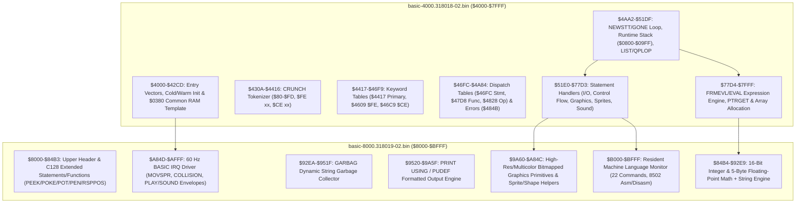

# Phase 5 Deliverable 15: Commodore BASIC 7.0 Architecture

**Classification:** `CONFIRMED`  
**Primary ROMs Analysed:**
- `basic-4000.318018-02.bin` (16,384 bytes, mapped at `$4000–$7FFF`, CRC32 `2ee6e2fa`)
- `basic-8000.318019-02.bin` (16,384 bytes, mapped at `$8000–$BFFF`, CRC32 `d551fce0`)

---

## 1. Dual-ROM Logical & Physical Organization

Commodore BASIC 7.0 occupies 32 KB of logical ROM address space from `$4000` to `$BFFF`, split across two 16 KB mask ROM integrated circuits (`U34` 318018-02 at `$4000–$7FFF` and `U33` 318019-02 at `$8000–$BFFF`). Both chips are simultaneously visible when MMU Configuration Register `$D500` (`CR`) selects internal Function ROM (`bits 3:2 = %00` for `$8000–$BFFF` and `bits 5:4 = %00` for `$4000–$7FFF`, e.g., `$D500 = $00` or `$01`).

| Physical ROM | Address Range | Subsystem | Description |
|---|---|---|---|
| `318018-02` | `$4000–$4008` | Entry Jump Table | `$4000` Cold Start (`JMP $4009`), `$4003` Warm Start (`JMP $4023`), `$4006` IRQ Service (`JMP $A84D`) |
| `318018-02` | `$4009–$4278` | Startup & Init | MMU preconfiguration setup (`$4169`), vector/pointer init (`$4045`), VIC/SID init (`$419B`), banner (`$4142`) |
| `318018-02` | `$4279–$4309` | Common RAM Stub | 85-byte template copied to `$0380–$03D4` (`CHRGET` + Bank 0/1 indirect fetch helpers) |
| `318018-02` | `$430A–$46F9` | Tokenizer & Tables | `CRUNCH` (`$430A`) and three high-bit keyword tables (`$4417`, `$4609`, `$46C9`) |
| `318018-02` | `$46FC–$4A84` | Dispatch & Errors | Statement table (`$46FC`), Function table (`$47D8`), Operator table (`$4828`), 41 Error strings (`$484B`) |
| `318018-02` | `$4A82–$51DF` | Interpreter Core | `NEWSTT` (`$4AA2`), `GONE` (`$4B68`), `ERROR` (`$4D3C`), `MAIN` (`$4DC6`), Software Stack (`$4FAA`), `LIST` (`$50E2`) |
| `318018-02` | `$51E0–$77D3` | Command Handlers | Core BASIC V2/V7 statements, structured loops (`DO`/`LOOP`), graphics (`BOX`/`CIRCLE`/`PAINT`/`DRAW`), `SPRITE`, `SOUND` |
| `318018-02` | `$77D4–$7FFF` | Expression & Vars | `FRMEVL` (`$77EF`), `EVAL` (`$78D7`), `PTRGET` (`$7AAF`), and array lookup/allocation (`$7CAB–$7E70`) |
| `318019-02` | `$8000–$84B3` | Extended Handlers | Upper header (`$8000`), `PEEK` (`$80C5`), `POKE` (`$80E5`), `ERR$` (`$80F6`), `RGR`/`RCLR`/`JOY`/`POT`/`PEN`/`RSPPOS` |
| `318019-02` | `$84B4–$951F` | Math & Strings | Integer/FP conversions, string descriptor/heap allocator (`$85AE`), 5-byte FP math (`$882E`), `GARBAG` (`$92EA`) |
| `318019-02` | `$9520–$A84C` | Formatting & GFX | `PRINT USING` (`$9520`), bitmapped plotting/line-drawing (`$9B00+`), `$1C00–$3FFF` bitmap relocation (`$9F4F`/`$A022`), `DIRECTORY`/`HEADER`/`DLOAD`/`DSAVE` (`$A36E+`) |
| `318019-02` | `$A84D–$AFFF` | BASIC IRQ Engine | 60 Hz interrupt driver (`$A84D`) called by KERNAL IRQ after screen editor service |
| `318019-02` | `$B000–$BFFF` | ML Monitor | Resident 4 KB Machine Language Monitor (`$B000` cold, `$B003` `BRK`, `$B006` parser) |

---

## 2. BASIC Startup & Dual-Bank Memory Architecture

### 2.1 Entry Points and Cold/Warm Initialization (`$4000–$4278`)
When the C128 KERNAL completes hardware and Editor initialization without detecting an autostart cartridge, it transfers control to `$4000` (`JMP $4009`).

1. **MMU Preconfiguration Setup (`$4169–$419A`):**
   BASIC 7.0 programs the four MMU Preconfiguration Registers (`$D501–$D504`) at `$417D–$4188` using values from `$4197–$419A`:
   - **`$D501 (PCRA) = $3F`:** Bank 0 full RAM (`$0000–$FFFF`, I/O enabled at `$D000–$DFFF`) — activated via `STA $FF01` (`LCRA`).
   - **`$D502 (PCRB) = $7F`:** Bank 1 full RAM (`$0000–$FFFF`, I/O enabled at `$D000–$DFFF`) — activated via `STA $FF02` (`LCRB`).
   - **`$D503 (PCRC) = $01`:** Bank 0 RAM + BASIC (`$4000–$BFFF`) + KERNAL (`$C000–$FFFF`) + I/O — activated via `STA $FF03` (`LCRC`).
   - **`$D504 (PCRD) = $41`:** Bank 1 RAM + BASIC (`$4000–$BFFF`) + KERNAL (`$C000–$FFFF`) + I/O — activated via `STA $FF04` (`LCRD`).
   - **Common RAM (`$D506 = $04`):** The bottom 1 KB (`$0000–$03FF`) of Bank 0 RAM is shared as Common RAM across both Bank 0 and Bank 1, keeping zero-page pointers (`$00–$FF`), the 8502 hardware stack (`$0100–$01FF`), the input buffer (`$0200–$02A0`), and the `$0380–$03D4` bank-switching stub accessible regardless of which RAM bank is active.

2. **Common RAM Stub Installation (`$406A–$4074`):**
   Copies 85 bytes from `$4279–$42CD` to `$0380–$03D4`:
   - **`$0380` (`CHRGET`) / `$0386` (`CHRGOT`):** Increments `TXTPTR` (`$3D/$3E`), executes `STA $FF01` (activating Bank 0 RAM via `LCRA`), reads the program byte `LDA ($3D),Y`, and executes `STA $FF03` (restoring BASIC/KERNAL ROMs via `LCRC`). Skips spaces (`$20`) and clears Carry if the byte is an ASCII digit (`'0'–'9'`).
   - **`$039F–$03AA` (`FETCH_BANK0`):** Takes a zero-page pointer address in `A`, patches `$03A4`, executes `STA $FF01; LDA ($zp),Y; STA $FF03; RTS` to read a byte from Bank 0 RAM.
   - **`$03AB–$03B6` (`FETCH_BANK1`):** Takes a zero-page pointer address in `A`, patches `$03B0`, executes `STA $FF02; LDA ($zp),Y; STA $FF04; RTS` to read a byte from Bank 1 RAM.
   - **`$03B7–$03BF`:** Reads `($24),Y` from Bank 1 RAM (`STA $FF02; LDA ($24),Y; STA $FF04; RTS`).
   - **`$03C0–$03C8`:** Reads `($26),Y` from Bank 0 RAM (`STA $FF01; LDA ($26),Y; STA $FF03; RTS`).
   - **`$03C9–$03D1`:** Reads `($3D),Y` from Bank 0 RAM without incrementing `TXTPTR`.

3. **Split Bank 0 / Bank 1 Memory Map (`$4075–$4106`):**
   Unlike C64 BASIC V2 (where program text, variables, arrays, and strings compete for a single 38 KB RAM region), BASIC 7.0 separates program code and data into two 64 KB banks:

| Bank | Pointer / Address | Initial Value | Purpose |
|---|---|---|---|
| **Bank 0** | `TXTTAB` (`$2D/$2E`) | `$1C01` (or `$4001` in bitmap mode) | Start of BASIC tokenized program text (`$1C00 = $00` header byte) |
| **Bank 0** | `EOP` (`$1210/$1211`) | `$1C03` | End of BASIC program text in Bank 0 (immediately follows `$00 $00` end-of-program link) |
| **Bank 0** | `MEMSIZ0` (`$1212/$1213`) | `$FF00` | Top of available Bank 0 program RAM |
| **Bank 0** | `TOS` (`$7D/$7E`) | `$09FF` | Software Control-Flow Stack (`$0800–$09FF`, 512 bytes growing downward) |
| **Bank 1** | `VARTAB` (`$2F/$30`) | `$0400` | Start of simple 7-byte variables in Bank 1 (immediately above Common RAM `$0000–$03FF`) |
| **Bank 1** | `ARYTAB` (`$31/$32`) | `$0400` | Start of array storage in Bank 1 (immediately above simple variables) |
| **Bank 1** | `STREND` (`$33/$34`) | `$0400` | End of array storage / bottom of free variable space in Bank 1 |
| **Bank 1** | `FRETOP` (`$35/$36`) | `$FF00` | Bottom of dynamic string pool in Bank 1 (grows downward from `MEMSIZ1`) |
| **Bank 1** | `MEMSIZ1` (`$39/$3A`) | `$FF00` | Top of dynamic string pool in Bank 1 |
| **Common** | `BANK` (`$03D5`) | `$0F` (Bank 15) | Default bank number (`0–15`) used by `PEEK`, `POKE`, `SYS`, `FETCH`, `STASH`, `SWAP` |

---

## 3. Command Loop, Program Storage & Error Handling

### 3.1 Interactive Command Loop (`READY.` at `$4D37`, `MAIN` at `$4DC6`)
- **`$4D37`:** Prints `<CR>READY.<CR>` and falls through to `$4DC6` (`JMP ($0302)` -> `$4DC9`).
- **`$4DC9–$4DF6` (`MAIN`):** Calls `$569C` (`INLIN`) to read a line via KERNAL `BASIN` (`$FFCF`) into `$0200–$02A0`. Calls `CHRGET` (`$0380`) and tests if the line starts with an ASCII digit:
  - **Direct Mode (no line number):** Calls `CRUNCH` (`$430A`) via `($0304)` and jumps to `$4AA8` (`NEWSTT`) with `CURLIN` high byte `$3C = $FF` (indicating Direct Mode).
  - **Program Line Entry (starts with line number):** Calls `LINGET` (`$50A0`) to parse the 16-bit line number into `$16/$17` (max `63999`, `$F9FF`), calls `CRUNCH` (`$430A`), searches Bank 0 program text via `FNDLIN` (`$5064`), deletes any existing line with the same number (`$4E2B–$4E63`), inserts the new tokenized line into Bank 0 (`$4E64–$4ED5`), relinks all line pointers via `LNKPRG` (`$4F4F`), and loops back to `$4DC6`.

### 3.2 Program Storage Format in Bank 0 (`$1C01+`)
Each BASIC line in Bank 0 RAM consists of:
1. **2-byte Next-Line Pointer (`lo, hi`):** Address in Bank 0 of the next line's link pointer (`$0000` marks the end of the program).
2. **2-byte Line Number (`lo, hi`):** Unsigned 16-bit integer (`0–63999`).
3. **Tokenized Body:** High-bit tokens (`$80–$FD`), 2-byte extended tokens (`$FE $02..$26`, `$CE $02..$0A`), and literal ASCII bytes.
4. **Terminator:** Single `$00` byte.

### 3.3 Error Handling, `TRAP`, `RESUME`, and `ERR$` (`$4D3C–$4DC5`, `$5F4D–$5FC8`, `$80F6`)
- **Central Error Entry (`$4D3C` -> `JMP ($0300)` -> `$4D3F`):**
  - Entered with the 1-based error code (`$01–$29`) in register `X`.
  - Records the error number in `$120B` (`ERRNUM`) and the offending line number in `$120C/$120D` (`ERRLIN`).
  - **Runtime Error Trapping (`$4D70–$4D88`):** If the program is running (`$3C != $FF`) and `TRAP` is active (`$120A != $FF`), BASIC copies `$1209/$120A` (`TRAPLIN`) into `$16/$17`, disables `TRAP` (`LDA #$FF; STA $120A` to prevent infinite error loops), saves the error text pointer in `$120E/$120F`, and jumps to `GOTO` (`$5238`) to transfer execution to the trap handler line!
  - **`RESUME` (`$5F62`):** Restores execution from `$120C/$120D` (`RESUME` retry statement, `RESUME NEXT` advance to next colon/line, or `RESUME <line>`).
  - **`ERR$(n)` (`$80F6`):** Calls `$4A82` to scan `$484B` and returns a dynamic string containing the text of error code `n` (`1–41`).

---

## 4. Tokenization (`CRUNCH` at `$430A`) and Expansion (`LIST` at `$514E`)

1. **`CRUNCH` (`$430A`, vectored via `$0304` `ICRNCH` -> `$430D`):**
   - Scans raw characters from `$0200,X`. Inside quotes (`"`), after `DATA` (`$83`), or after `REM` (`$8F`), characters are copied verbatim without tokenization.
   - Outside quotes, `?` is converted immediately to `$99` (`PRINT` at `$434A`).
   - For alphabetic characters (`A–Z`), `CRUNCH` searches three keyword tables in order:
     1. **`$4609` (`$FE`-prefixed statements, `$4356`):** If matched and not immediately followed by `(` (`$43A9`: prevents `MID$(` or `LEFT$(` from matching prefix substrings), emits two bytes: `$FE` followed by `sub_token` (`$02..$26`).
     2. **`$46C9` (`$CE`-prefixed functions, `$4365`):** If matched, emits two bytes: `$CE` followed by `sub_token` (`$02..$0A`).
     3. **`$4417` (Primary tokens, `$4370`):** If matched, emits single byte `$80 + index` (`$80..$FD`). Notice that index 78 (`$CE` at `$452B`) is a 1-byte shifted space (`$A0`), ensuring `$CE` is never emitted as a primary keyword.
   - If the matched token is `$8B` (`IF`, checked at `$4396`), `CRUNCH` continues scanning normally; if `$D5` (`ELSE`), it automatically inserts a preceding `:` (`$3A`) if not already present (`$437B–$4389`) so statement execution stops cleanly before an `ELSE` branch!

2. **Token Expansion (`QPLOP` at `$514E`, vectored via `$0306` `IQPLOP` -> `$5151`):**
   - When `LIST` (`$50E2`) encounters a byte with bit 7 set (`>= $80`) outside quotes:
     - If `$FE` (`$515B -> $518C`): Fetches the next byte from Bank 0, verifies `$02 <= sub < $27`, and expands entry `sub - 2` from `$4609`.
     - If `$CE` (`$515F -> $51A6`): Fetches the next byte from Bank 0, verifies `$02 <= sub < $0B`, and expands entry `sub - 2` from `$46C9`.
     - Otherwise (`$5163`): Expands entry `tok - $80` from `$4417` until the high-bit character is printed.

---

## 5. Execution Engine (`NEWSTT`, `GONE`, `FRMEVL`, Math, Strings, Control Flow)

### 5.1 Statement Dispatcher (`NEWSTT` at `$4AA2`, `GONE` at `$4B3F`)
- **`NEWSTT` (`$4AA2`):** Checks `STOP` key (`$4AA5 -> JSR $FFE1`), updates `OLDTXT` (`$1202/$1203`), handles `TRON` line-number tracing (`$1216` at `$4AC9–$4AF5`), and advances to the next statement (`:` or next line in Bank 0).
- **`GONE` (`$4B3F`, vectored via `$0308` `IGONE` -> `$4B42`):**
  - Calls `CHRGET` (`$0380`). If the byte is `< $80`, defaults to implicit `LET` assignment (`JMP $5831`).
  - If `= $FE` (`$4B62 -> $4B94`): Reads the sub-token via `CHRGET`, checks `$02 <= sub < $27`, adds `$47` (`Carry=0`, yielding table index `73..109`), pushes the `RTS-1` vector from `$46FC,Y`, advances `CHRGET`, and dispatches via `RTS`.
  - If `$80..$A2` (`$4B6C`): Subtracts `$80` (yielding table index `0..34`) and dispatches via `$46FC,Y`.
  - If `$D5..$FA` (`$4B70`): Subtracts `$32` (`Carry=1`) and `$80` (yielding table index `35..72`) and dispatches via `$46FC,Y`.

### 5.2 Expression Parsing (`FRMEVL` at `$77EF`, `EVAL` at `$78D7`)
- **`FRMEVL` (`$77EF`):** Operator-precedence parser that pushes intermediate 5-byte floating-point operands and operator precedence bytes onto the hardware stack (`$0100–$01FF`) while consulting the 10-entry `OPTAB` at `$4828–$4845`.
- **`EVAL` (`$78D7`, vectored via `$030A` `IEVAL` -> `$78DA`):** Evaluates a primary term:
  - Numeric literals (decimal or `$hex` via `$837C` / `FIN` `$8D2A`).
  - String literals (`"..."` at `$7913`).
  - Unary `NOT` (`$A8`), `FN` (`$A5`), or parenthesized sub-expressions `(...)`.
  - Built-in functions `$B4..$D4` and `$CE $02..$0A` (`$4BEF–$4C85`), dispatched via `JMP ($0057)` using the 40-entry table at `$47D8–$4827`.
  - Variables and array elements via `PTRGET` (`$7AAF`) and `ISVAR` (`$7976`).

### 5.3 Floating-Point & Integer Representation (`$63–$72`, `$84B4–$90CF`)
- **FAC1 (`$63–$68`):** `$63` = Exponent (bias `$80`), `$64–$67` = 32-bit normalized mantissa (MSB first), `$68` = Sign byte (`$00` positive, `$FF` negative).
- **FAC2 (`$6A–$6F`):** Secondary accumulator in the same format; `$70` holds the sign comparison (`ARISGN`), and `$0F` (`VALTYP`) is `$00` for numeric or `$FF` for string.
- **16-Bit Signed Integers:** Stored in variables (`X%`) and arrays as big-endian 2-byte signed values (`-32768..+32767`), converted to/from FAC1 via `QINT`/`AYINT` (`$84B4`) and `GIVAYF` (`$84C9`).

### 5.4 Bank 1 Variable, Array, and Dynamic String Management
- **Variable Lookup (`PTRGET` at `$7AAF`):** Scans Bank 1 RAM from `VARTAB` (`$2F/$30 = $0400`) to `ARYTAB` (`$31/$32`) in 7-byte records using `STA $FF02` / `STA $FF04`. If not found, shifts arrays upward in Bank 1 (`$79E4`) and initializes a new 7-byte entry (`[char1, char2, b0, b1, b2, b3, b4]`).
- **Arrays (`$7CAB–$7E70`):** Stored in Bank 1 between `ARYTAB` (`$31/$32`) and `STREND` (`$33/$34`) with header `[name1, name2, byte_size_lo, byte_size_hi, num_dims, dim_N_hi, dim_N_lo, ...]`.
- **Strings & Back-Pointer Garbage Collection (`$85AE–$879E`, `GARBAG` at `$92EA`):**
  - Unlike C64 BASIC V2's slow $O(N^2)$ garbage collector, BASIC 7.0 allocates **2 extra back-pointer bytes** at the end of every dynamic string in Bank 1 (`$86BD–$86CA`), pointing back to the variable or array descriptor that owns the string (`$FF` marks temporary/unowned strings).
  - Consequently, `GARBAG` (`$92EA`) compacts the entire 64 KB Bank 1 string heap in **linear $O(N)$ time** by walking downward from `MEMSIZ1` (`$39/$3A`) to `FRETOP` (`$35/$36`)!

### 5.5 Software Control-Flow Stack (`$0800–$09FF` in Bank 0)
Managed by `$4FAA–$5063` via top-of-stack pointer `TOS` (`$7D/$7E`, initialized to `$09FF`):
- **`FOR` (`$5746`) / `NEXT` (`$5D63`):** Pushes an 18-byte frame (`tag = $81`, loop variable address in Bank 1, 5-byte `STEP`, sign, 5-byte `TO` limit, line number, `TXTPTR`).
- **`GOSUB` (`$521F`) / `RETURN` (`$5262`):** Pushes a 5-byte frame (`tag = $8D`, `CURLIN` lo/hi, `TXTPTR` lo/hi).
- **`DO` (`$5FF6`) / `LOOP` (`$608C`) / `EXIT` (`$6037`):** Pushes a 5-byte frame (`tag = $EB`, `CURLIN` lo/hi, `TXTPTR` lo/hi).
- **`IF` (`$5986`) / `THEN` (`$59A7`) / `ELSE` (`$59D6`) & `BEGIN` (`$59D4`) / `BEND` (`$59D9`):** `IF` evaluates FAC1; if false (`$63 == 0`), `$59E3` scans forward counting nested `BEGIN` (`$FE $18`) and `BEND` (`$FE $19`) blocks until a matching `ELSE` (`$D5`) or end-of-line is found.
