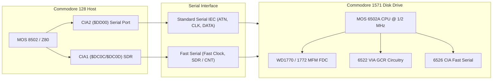

# PHASE 9 DELIVERABLE 1: COMMODORE 1571 DISK ARCHITECTURE, BURST PROTOCOL & D71/D64 SPECIFICATION

**Project:** `cbm-128-core` (Commodore 128 1985 Firmware & Hardware Analysis)  
**Target Hardware:** Commodore 1571 Floppy Disk Drive, MOS 8502, Zilog Z80A, MOS 6526 CIA1/CIA2  
**Target Firmware:** `z80bios.bin` (`$018C–$0525`, `$0D22–$0EE4`), `kernal.318020-03.bin` (`$F890–$F9FB`), `CPM+.SYS`  
**Methodology Classification:** `CONFIRMED`

---

## 1. Executive Summary & Hardware Architecture

The Commodore 1571 is a dual-mode, double-sided 5¼-inch floppy disk drive developed alongside the Commodore 128 in 1985. It incorporates:
1. **MOS 6502A CPU** clocked at 1 MHz (C64/1541 mode) or 2 MHz (C128 burst mode),
2. **32 KB ROM** containing the Commodore 1571 DOS 3.0,
3. **2 KB internal RAM** ($0000–$07FF),
4. **Dual 6522 VIA** controllers for motor, head-stepping, and GCR read/write circuitry,
5. **MOS 6526 CIA** handling the fast serial bus and hardware shift register, and
6. **Western Digital WD1770 / WD1772 MFM Floppy Disk Controller (FDC)** enabling native reading and writing of double-density MFM disks (including IBM PC, CP/M System 24, Osborne, Kaypro, and standard CP/M formats).



---

## 2. Standard Serial IEC vs Fast Serial Burst Transfer Protocol

### 2.1 Standard Serial IEC Protocol (1541 Mode)
- **Lines:** `ATN` (Attention), `CLK` (Clock), `DATA` (Data).
- **Control:** Software bit-banging performed on **CIA2 Port A (`$DD00`)**:
  - Bit 3 (`$08`): `CLK OUT`
  - Bit 4 (`$10`): `DATA OUT`
  - Bit 5 (`$20`): `ATN OUT`
  - Bit 6 (`$40`): `CLK IN`
  - Bit 7 (`$80`): `DATA IN`
- **Throughput:** ~300 to 400 bytes/second due to 8502 software bit-interleaving and interrupt delays.
- **CP/M Impact:** Single-sector read takes ~600 ms. Loading a full 25 KB `CPM+.SYS` image takes ~60 seconds.

### 2.2 Fast Serial Burst Transfer Protocol (1571 Mode)
- **Lines:** Fast Clock (pin 6 on DIN) connected to **CIA1 CNT (`$DC00`)**; Fast Data (pin 1 on DIN) connected to **CIA1 Serial Data Register (`$DC0C` SDR)**.
- **Hardware Acceleration:** When sending or receiving bytes in Burst mode, the hardware shift registers inside the C128's CIA1 (`$DC0C`) and the 1571's CIA automatically deserialize 8 bits at 2 MHz into a complete byte, triggering bit 3 in the Interrupt Control Register (`$DC0D`).
- **Throughput:** Up to **4,000 to 5,000 bytes/second** (~12x faster than 1541 IEC).
- **Fast Serial Handshake in C128 KERNAL & Z80 Slave Driver:**
  - Handshake line toggled via `CIA2_PRA ($DD00) bit 4`:
    ```6502
    $3150: LDA $DD00
           EOR #$10
           STA $DD00        ; Toggle Fast Serial handshake
    $315A: BIT $DC0D
           BEQ $315A        ; Wait for CIA1 SDR 8-bit shift complete
    $315F: LDA $DC0C        ; Read full byte from hardware shift register
           STA ($20),Y      ; Store into destination RAM buffer
    ```
  - Fast Serial Presence Flag: Memory location `$0A1C` bit 6 (`FSDRIVE`) is tested during drive initialization (`$3105: BIT $0A1C; BVS $3130`). If set, `$FD08` is configured to `$0F` (Burst mode active); if clear, `$FD08` is set to `$00` (1541 slow IEC fallback).

---

## 3. Physical Disk Geometries: D64 vs D71

### 3.1 D64 Image Format (Commodore 1541 / Single-Sided)
- **Total Tracks:** 35 (Tracks 1–35, Side 0 only).
- **Total Sectors:** 683 sectors.
- **File Size:** **174,848 bytes** ($02AA00).
- **Zone Geometry (4 Speed Zones):**
  - Tracks 1–17: 21 sectors/track (sectors 0–20) = 357 sectors
  - Tracks 18–24: 19 sectors/track (sectors 0–18) = 133 sectors (Track 18 = BAM/Directory)
  - Tracks 25–30: 18 sectors/track (sectors 0–17) = 108 sectors
  - Tracks 31–35: 17 sectors/track (sectors 0–16) = 85 sectors

### 3.2 D71 Image Format (Commodore 1571 / Double-Sided)
- **Total Tracks:** 70 (Tracks 1–35 = Side 0; Tracks 36–70 = Side 1).
- **Total Sectors:** 1,366 sectors (or 1,360 standard GCR sectors).
- **File Size:** **349,696 bytes** ($055600).
- **Side 1 Layout:** Logical continuation of Side 0 tracks:
  - Track 36 corresponds to Physical Track 1 on Side 1 (21 sectors)
  - Track 53 corresponds to Physical Track 18 on Side 1 (19 sectors)
  - Track 70 corresponds to Physical Track 35 on Side 1 (17 sectors)

---

## 4. CP/M 3.0 Disk Allocation & Sector Interleaving

Commodore CP/M Plus 3.0 formats floppy disks with **5:1 sector interleave** to optimize rotational throughput without requiring a full-track cache.

### 4.1 Sector Interleave Tables (from `z80bios.bin` `$0FB5–$0FFF`)
```text
Zone 0 (21 sectors/track, Tracks 1-17 & 36-52):
  0,  5, 10, 15, 20,  4,  9, 14, 19,  3,  8, 13, 18,  2,  7, 12, 17,  1,  6, 11, 16

Zone 1 (19 sectors/track, Tracks 18-24 & 53-59):
  0,  5, 10, 15,  1,  6, 11, 16,  2,  7, 12, 17,  3,  8, 13, 18,  4,  9, 14

Zone 2 (18 sectors/track, Tracks 25-30 & 60-65):
  0,  5, 10, 15,  2,  7, 12, 17,  4,  9, 14,  1,  6, 11, 16,  3,  8, 13

Zone 3 (17 sectors/track, Tracks 31-35 & 66-70):
  0,  5, 10, 15,  3,  8, 13,  1,  6, 11, 16,  4,  9, 14,  2,  7, 12
```

### 4.2 Allocation Block & Directory Sizing
| Parameter | 1541 / D64 (`$FEFF = $00`) | 1571 / D71 (`$FEFF = $FF`) |
|---|---|---|
| **Allocation Block Size** | **1,024 bytes** (4 sectors) | **2,048 bytes** (8 sectors) |
| **Directory Allocation Blocks** | Blocks 0 & 1 (2 KB total) | Blocks 0 & 1 (4 KB total) |
| **Max Directory Entries** | 64 entries (32 per block) | 128 entries (64 per block) |
| **Directory Track/Sector** | Track 1, Sectors 5, 10, 15... | Track 1, Sectors 5, 10, 15... |
| **Max Disk Storage (TPA)** | ~170 KB | ~340 KB |
| **Boot Sector** | Track 1, Sector 0 | Track 1, Sector 0 |

---

## 5. The Hardware Boot Sequence Trace

1. **Hardware Power-On:** Z80 starts at `$0000`, initializes MMU, and switches to MOS 8502 at `$1100 -> $E000`.
2. **KERNAL `BOOT_CALL` (`$F890`):**
   - 8502 queries Drive 8 for Track 1, Sector 0 into `$0B00–$0BFF`.
   - Checks `$0B00–$0B02` for ASCII `"CBM"`.
   - If `"CBM"` is found, calls `JSR $02CD` (`$0B09`).
   - The boot code at `$0B09` executes `SEI; JSR $FF84; LDA #$3E; STA $FF00; LDA #$B0; STA $D505`, switching bus control directly back to the Z80.
3. **Z80 CP/M Loader (`$018C`):**
   - Resumes at `$FFEE` (`RST $08 -> $0008 -> $018C`).
   - Installs 8502 Slave Driver into `$3000–$31C2` and patches `$FFEE` to `RET` (`$C9`).
   - Calls `$02D2` to read Track 1, Sector 0 into `$FE00`.
   - Verifies `"CBM"` signature and inspects `$FEFF`.
   - Searches directory blocks for `"CPM+    SYS"`.
   - Extracts 12-byte header from `CPM+.SYS`:
     - `COMMON CODE`: Loaded descending from `$FC00` (18 pages = 4.5 KB).
     - `BANKED CODE`: Loaded descending from `$E000` (71 pages = 17.75 KB).
     - `BIOS8502 CODE`: Loaded descending from `$2B00` down to `$2600` (5 pages = 1.25 KB).
     - `DATA TABLES`: Loaded ascending into `$1000` (4 pages = 1 KB).
   - Patches `$FFDD/$FFDE` to point to the runtime 8502 BIOS driver at `$2600`.
   - Jumps to CP/M 3.0 entry point at `$F000` (`JP (HL)`).
4. **CP/M 3.0 Runtime Disk Subsystem & Sector Buffering:**
   - Runtime CP/M 3.0 disk operations originate from BDOS in Z80 Bank 1.
   - BDOS invokes BIOS `READ` (`$F027 -> $C790`) or `WRITE` (`$F02A -> $C7A5`).
   - The Z80 BIOS disk driver (`$D38F`) converts logical CP/M records into physical Track (`$FD03`) and Sector (`$FD04`).
   - The 8502 BIOS at `$2600` is summoned via `CALL $FFE6`, which commands the 1571 drive to read the physical 256-byte sector into the internal BIOS sector buffer at `$FE00` in Bank 0 (Common RAM).
   - Upon return to the Z80 at `$D3A8`, the routine at `$FA5F` configures the destination MMU bank via Preconfiguration Register PCR A/B (`$FF01/$FF02`) and executes `LDIR`, transferring 256 bytes from `$FE00` to `($D8FF)` (the BDOS data/directory cache or user DMA buffer).
   - For 1 KB logical disk blocks (such as the directory), the Z80 driver loops 4 times (`$D55F`), reading consecutive interleaved physical sectors into `$7400`, `$7500`, `$7600`, and `$7700`.
5. **Operating System Online & Command Execution:**
   - BDOS opens and loads `CCP.COM` (Command Control Processor) into the Transient Program Area (TPA) at `$0100` in Bank 1.
   - CCP executes and renders the authentic `A>` prompt.
   - Console input (`CONIN` via `$F188 -> $F325 -> $CA59`) retrieves keyboard characters from `$2471` in Bank 0 RAM (or scans the CIA1 keyboard matrix at `$DC00/$DC01`).
   - Interactive commands such as `DIR` query the genuine directory records through BDOS and display the files on the attached disk.
