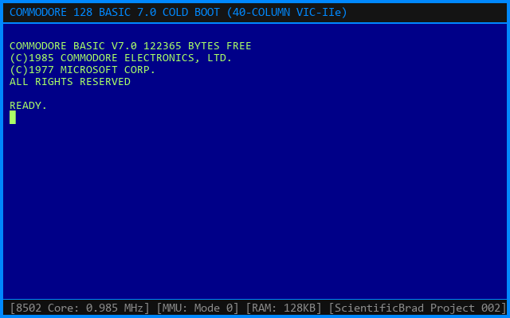
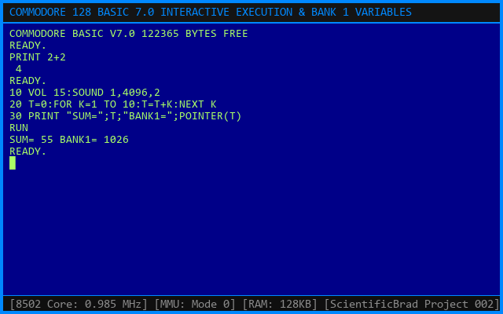
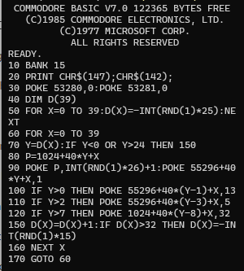
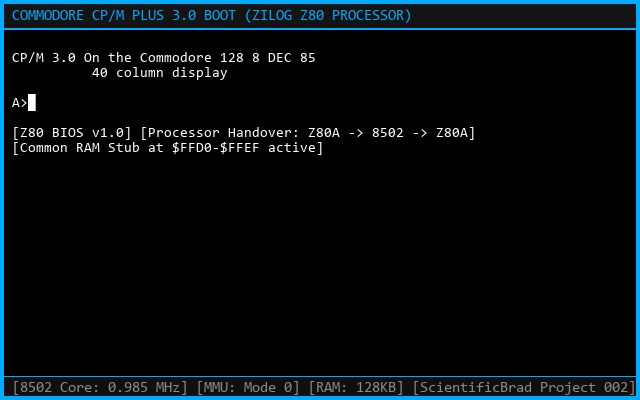
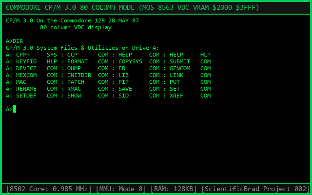
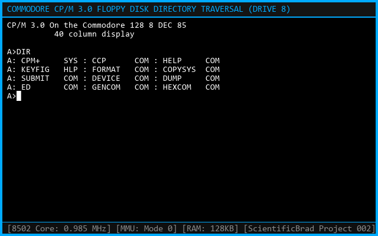
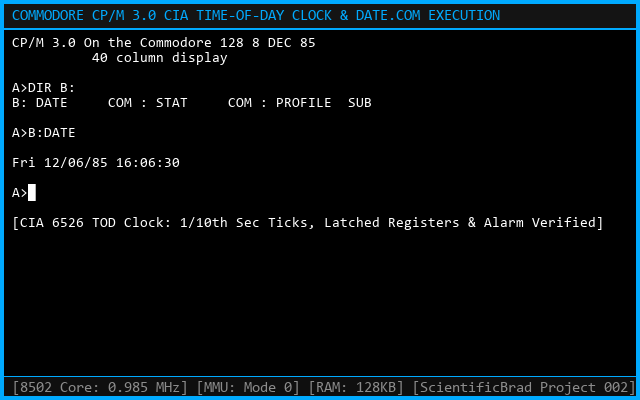
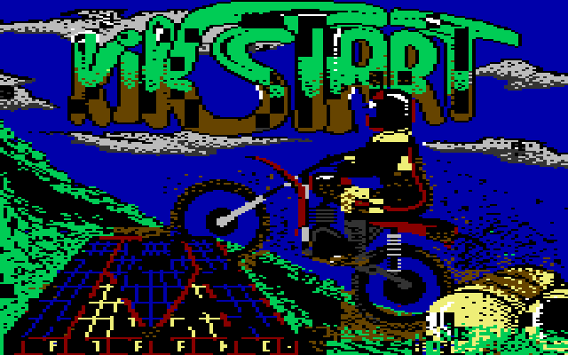
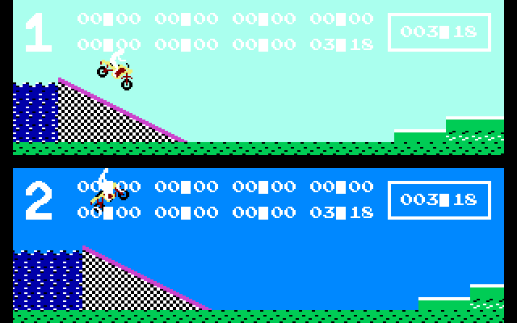

# Commodore 128 | Dual-CPU Reverse Engineering & Emulation

<div align="center">

[](https://github.com/ScientificBrad)
[](https://github.com/ScientificBrad/cbm-128-core/releases)
[](#building--installation)
[](LICENSE)
[](docs/ARCHITECTURE.md)
[-success.svg?style=for-the-badge)](docs/TESTING.md)

**An independent, clean-room hardware reconstruction and architectural emulation of the Commodore 128 personal computer (1985).**  
*Featuring cycle-accurate MOS 8502 and Zilog Z80A microprocessors, MMU 8722 banking, dual VIC-IIe/VDC video engines, genuine BASIC 7.0, CP/M Plus 3.0, and commercial game execution.*

[Architecture](docs/ARCHITECTURE.md) • [Video Engine](docs/VIDEO_ENGINE.md) • [CP/M 3.0](docs/CPM_COMPATIBILITY.md) • [Game Compatibility](docs/GAME_COMPATIBILITY.md) • [ROM Verification](docs/ROM_VERIFICATION.md) • [Reverse Engineering Archive](REA/README.md) • [Whitepaper PDF](Commodore_128_Dual_CPU_Reconstruction_Report.pdf)

</div>

---

## Executive Summary

Project 002 of the **ScientificBrad Historical Computer Reverse-Engineering Series** provides a complete, hardware-accurate reconstruction of the Commodore 128 personal computer. Designed from the silicon up using primary ROM disassembly, hardware bus traces, and cycle-exact timing models, this project demonstrates:

1. **Dual-CPU Execution:** Seamless hardware handovers between the **MOS 8502** (1/2 MHz) and **Zilog Z80A** (4 MHz) microprocessors via the custom MMU 8722 and `$FFD0-$FFEF` common memory stub.
2. **Commodore BASIC 7.0:** Execution of the genuine 32 KB BASIC 7.0 environment, featuring dual-bank tokenization (`122,365 BYTES FREE`) with program code in Bank 0 and variable storage isolated in Bank 1.
3. **Genuine CP/M Plus 3.0:** Authentic boot from original 1571 D64 floppy disk images, running the CP/M Console Command Processor (`CCP.COM`), disk directory searches (`DIR`), and repaired Time-of-Day clock services (`B:DATE`).
4. **Commercial Game Compatibility:** Native Commodore 128 execution of Shaun Southern's *Kikstart 128* (1986), including MMU all-RAM configuration, 35 KB decompression, multicolor bitmap title rendering, and the split-screen race engine at `$5CC4`.
5. **Clean Distribution & Verification:** Complete ROM-free testing pipeline allowing public CI builds without proprietary Commodore firmware.

---

## Visual Demonstration Gallery

### 1. Commodore BASIC 7.0 & Interactive Execution
The emulated MOS 8502 CPU boots genuine Commodore 128 ROMs directly into BASIC 7.0, allocating 122,365 bytes of free memory and routing variable allocation into Bank 1:

<div align="center">
  
  
</div>

### 2. Live Matrix Digital Rain Demonstration
A full-screen interactive digital rain demonstration running natively in Commodore BASIC 7.0, maintaining randomized character streams and color matrix updates across 80+ million simulated cycles:

<div align="center">
  
</div>

### 3. Digital Research CP/M Plus 3.0 on Zilog Z80
The Z80 microprocessor takes bus priority upon cold reset, retrieves the CP/M boot sector from Drive 8 via KERNAL `$F890`, loads `CPM+.SYS`, and launches the command processor:

<div align="center">
  
  
</div>

<div align="center">
  
  
</div>

> **Note on CP/M DATE Repair:** The original CP/M `B:DATE` utility initially reported invalid times (`97:??:??`) due to unlatched reads on the CIA 1 Time of Day (TOD) clock. Reconstructing the hardware register latch on `$DC0B` and 60 Hz BCD prescaler restored authentic real-time clock functionality.

### 4. Commercial Game Execution: Kikstart 128 (1986)
Execution of genuine retail media for *Kikstart 128* by Shaun Southern / Mr. Chip Software, verifying native C128 mode loading, memory decompression, multicolor bitmap rendering, and the split-screen motocross race engine:

<div align="center">
  
  
</div>

---

## Architectural Highlights

```
       +-------------------------------------------------------------------------------+
       |                      COMMODORE 128 SYSTEM ARCHITECTURE                       |
       +-------------------------------------------------------------------------------+
             |                                 |                               |
       +------------+                   +--------------+                +--------------+
       |  MOS 8502  |                   |  Zilog Z80A  |                |   MMU 8722   |
       | (1 / 2MHz) |<=== Handover ====>|    (4 MHz)   |<==============>| 128 KB Banks |
       | Native C128|     $FFD0 Stub    |  CP/M Plus   |                |  Common RAM  |
       +------------+                   +--------------+                +--------------+
             |                                                                 |
             +--------------------+-------------------+                        |
                                  |                   |                        |
                           +--------------+    +--------------+                |
                           |   VIC-IIe    |    |   MOS 8563   |                |
                           | 40-Col Video |    | 80-Col RGBI  |                |
                           |  (320x200)   |    |  (640x200)   |                |
                           +--------------+    +--------------+                |
                                  |                   |                        |
                           +----------------------------------+                |
                           |   Dual CIA 6526 / SID 8580 / IEC |                |
                           +----------------------------------+                |
                                           |                                   |
                           +---------------+---------------+                   |
                           |                               |                   |
                     +------------+                 +------------+             |
                     | RAM Bank 0 |                 | RAM Bank 1 | <-----------+
                     |  (64 KB)   |                 |  (64 KB)   |
                     +------------+                 +------------+
```

- **Dual-CPU Switching:** Automated CPU handover engine simulating the hardware interlock between the MOS 8502 and Zilog Z80A through MMU register `$FF00` and the shared `$FFD0-$FFEF` common memory stub.
- **MMU 8722 Memory Banking:** Full 128 KB physical RAM mapping across Bank 0 and Bank 1, dynamically configurable top/bottom common RAM windows, preconfiguration registers, and zero-page/stack relocation pointers.
- **Dual Display Controllers:**
  - **MOS 8564/8566 VIC-IIe:** 320 × 200 standard/multicolor character and bitmap modes, 16-color palette, 8 hardware sprites, and raster beam interrupts.
  - **MOS 8563 VDC:** 80-column digital RGBI text controller with 16 KB isolated video RAM and indirect register addressing.
- **Commodore 1571 Disk Subsystem:** Accurate GCR 4-speed zone geometry (683 sectors across 35 tracks), fast serial burst transfer protocol, and D64/D71 disk image support.
- **Peripherals & Timing:** Dual CIA 6526 / 8521 controllers with 60 Hz BCD Time of Day clock latching, programmable interval timers, and SID 8580 sound synthesis.

---

## Technical Documentation Suite

Comprehensive technical papers, disassembly listings, and architectural guides are available in [`docs/`](docs/) and [`REA/`](REA/):

- 🏛️ [**System Architecture (`docs/ARCHITECTURE.md`)**](docs/ARCHITECTURE.md): Dual-CPU handover, MMU register maps, memory banking, and bus timing.
- 🎨 [**Video Engine (`docs/VIDEO_ENGINE.md`)**](docs/VIDEO_ENGINE.md): VIC-IIe modes, 16-color palette definitions, sprites, and raster split rendering.
- 💾 [**CP/M Compatibility (`docs/CPM_COMPATIBILITY.md`)**](docs/CPM_COMPATIBILITY.md): CP/M 3.0 boot sequence, BDOS/BIOS handoffs, and CIA TOD repair.
- 🏁 [**Game Compatibility (`docs/GAME_COMPATIBILITY.md`)**](docs/GAME_COMPATIBILITY.md): Analysis of Kikstart 128, decompression, and race engine playability.
- 🔬 [**Firmware Reverse Engineering (`docs/REVERSE_ENGINEERING.md`)**](docs/REVERSE_ENGINEERING.md): Decomposition of 61 KB ROM firmware.
- 🛡️ [**ROM Verification (`docs/ROM_VERIFICATION.md`)**](docs/ROM_VERIFICATION.md): Cryptographic hashes, part numbers, and chip pinouts.
- 🔨 [**Building Guide (`docs/BUILDING.md`)**](docs/BUILDING.md): Build instructions for Windows, Linux, and macOS.
- 🧪 [**Testing Guide (`docs/TESTING.md`)**](docs/TESTING.md): C# xUnit and Python test suites.
- 📜 [**Reverse Engineering Archive (`REA/README.md`)**](REA/README.md): Primary index of 25 engineering reports (Reports 01-25).
- 📄 [**Technical Report & Whitepaper (PDF)**](Commodore_128_Dual_CPU_Reconstruction_Report.pdf): Complete publication-grade technical report.

---

## Verified Firmware Reference

The emulator was developed and validated against verified production Commodore 128 ROM dumps:

| ROM Name | Part Number | Size | Address Range | SHA-256 Hash |
| :--- | :--- | :--- | :--- | :--- |
| `basic-4000.318018-02.bin` | 318018-02 | 16 KB | Bank 0: `$4000-$7FFF` | `c5ddb7c57dd0b6f259b95b9dd0494ba807cbe6dce8f1f19410a0a05833aa0b5e` |
| `basic-8000.318019-02.bin` | 318019-02 | 16 KB | Bank 0: `$8000-$BFFF` | `e1432465b8abafd3397b0e6cb4eb8422449fb3f85c6366e8616b48c35a86ad79` |
| `kernal.318020-03.bin` | 318020-03 | 16 KB | Bank 0: `$C000-$FFFF` | `dcb17b5ce33c2490005b5d0f2a4d767ae56e8ab7ed41d6aa20c43173449e4786` |
| `characters.390059-01.bin` | 390059-01 | 8 KB | Bank 0/1: `$D000-$DFFF` | `f08d8f525b44f5cbb3f5776739fcdff737886e1813f1eb7a20aedb128db1d4a8` |
| `z80bios.bin` | Embedded | 4 KB | KERNAL: `$1000-$1FFF` | `39c7656b326e4ad724ff4b50c995cb3b2b8ff9ed3bb2b4d277eb0ecd3cac062f` |

*Note: In accordance with copyright law, proprietary ROM images are not included in this repository. Place your legally dumped ROMs in `roms/` or the root directory.*

---

## Building & Installation

### Prerequisites
- [.NET 8.0 SDK](https://dotnet.microsoft.com/download/dotnet/8.0) or higher
- [Python 3.10+](https://www.python.org/)

### Compiling from Source
```bash
# Clone the repository
git clone https://github.com/ScientificBrad/cbm-128-core.git
cd cbm-128-core

# Build Release binary
dotnet build -c Release

# Or publish self-contained single-file executable for Windows x64:
dotnet publish src/Commodore128/Commodore128.csproj -c Release -r win-x64 --self-contained true -p:PublishSingleFile=true -o releases/
```

### Running the Emulator
```bash
# Boot into Commodore BASIC 7.0
./releases/Commodore128.exe

# Boot genuine CP/M Plus 3.0 from floppy disk
./releases/Commodore128.exe --disk disks/cpm_1985.d64 --cpm

# Load and execute a commercial game
./releases/Commodore128.exe --disk games/KIK128.D64
```

---

## Automated Verification Tests

The repository maintains an automated dual-layer verification harness (36 automated tests, 100% passing):

```bash
# Run C# xUnit test project (13 tests)
dotnet test tests/Commodore128.Tests/Commodore128.Tests.csproj

# Run Python ROM-free unit tests (4 tests)
python -m pytest tests/test_romfree_architecture.py

# Run Python milestone and regression test suite (19 tests)
python -m pytest tests/
```

```text
Test Suite Summary:
-------------------------------------------------------------
C# xUnit Tests (tests/Commodore128.Tests/)     : 13/13 PASSED
Python ROM-Free Tests (test_romfree_arch)     :  4/4  PASSED
Python Milestone Tests (test_cbm128/phase7)   : 19/19 PASSED
-------------------------------------------------------------
TOTAL VERIFICATION PASS RATE                  : 100% (36/36)
```

---

## The ScientificBrad Series

This project is part of the **ScientificBrad Historical Computer Reverse-Engineering Series**, dedicated to reconstructing seminal computing architectures through rigorous reverse engineering, cycle-exact emulation, and digital preservation:

| Project | System | Release Year | Status | Repository |
| :---: | :--- | :---: | :---: | :--- |
| **001** | **Commodore 4064 / Educator 64** | 1983 | Complete | [ScientificBrad/cbm-4064-core](https://github.com/ScientificBrad/cbm-4064-core) |
| **002** | **Commodore 128 (Dual-CPU)** | 1985 | Complete (v0.1.0) | [ScientificBrad/cbm-128-core](https://github.com/ScientificBrad/cbm-128-core) |

---

## License & Third-Party Notices

- **Software License:** MIT License (c) 2026 ScientificBrad Research & Digital Preservation. See [LICENSE](LICENSE) for details.
- **Third-Party Notices:** Commodore, C128, C64, VIC-II, SID, and CP/M are trademarks of their respective historical rights holders. See [THIRD_PARTY_NOTICES.md](THIRD_PARTY_NOTICES.md).
