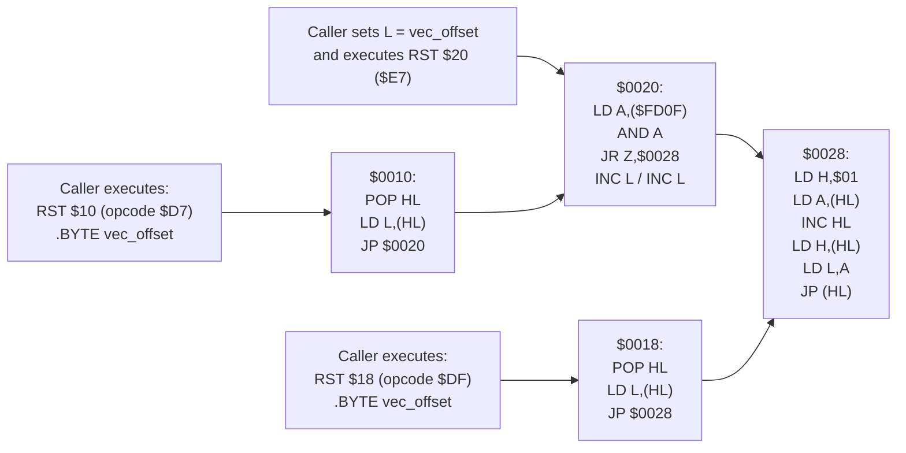

# Commodore 128 Z80 BIOS Control-Flow Graph (`z80bios.bin` / `252202-01`)

**Source Image:** `D:\Emulation\C128\z80bios.bin` (4,096 bytes, SHA-256 `39c7656b326e4ad724ff4b50c995cb3b2b8ff9ed3bb2b4d277eb0ecd3cac062f`)  
**CPU Architecture:** Zilog Z80A (`$0000-$0FFF` in Bank 0) + Embedded MOS 8502 Slave Payloads (`$0D1A-$0EF4`)  
**Classification:** `CONFIRMED`

---

## 1. Z80 BIOS Master Control-Flow Diagram

```mermaid
flowchart TD
    RESET["Hardware Power-On / Reset\nZ80 PC = $0000"] --> CR3E["$0000: LD A,$3E / LD ($FF00),A\nJP $003B"]
    CR3E --> COLD["$003B: Z80_COLD_START\n$D02F=$FF, $D030=$FC (1 MHz)\n$D505=$B0 (Z80 Active, C128 Mode)"]
    COLD --> CART{"$004D: IN A,($D505)\nCPL / AND $30\n/GAME or /EXROM low?"}
    CART -- "Yes (C64 Cart)" --> C64_SWITCH["$0054: LD A,$F1\nOUT ($D505),A\nRST $00 (Switch to C64 8502)"]
    CART -- "No" --> CIA_KEY["$0059: Init CIA1 ($DC00-$DC0F)\nScan Row $7F ($DC01 & $20)"]
    CIA_KEY --> CBM_HELD{"$0075: C= Key Held?"}
    CBM_HELD -- "Yes (Zero)" --> C64_SWITCH
    CBM_HELD -- "No (Non-Zero)" --> MMU_INIT["$007C: Copy $0FAA-$0FB4 -> $D500-$D50A\nCopy $0D1A (8B) -> $1100\nCopy $0EE5 (31B) -> $FFD0-$FFEF\nSet $FFFA/$FFFC/$FFFE/$FFDD = $1100"]
    MMU_INIT --> JP_FFE0["$00B1: JP $FFE0\n(Shared RAM Stub)"]

    subgraph SHARED_STUB["Shared RAM Dual-CPU Handoff Stub ($FFD0-$FFEF)"]
        JP_FFE0 --> STUB_Z80["$FFE0 (Z80):\nDI / LD A,$3E / LD ($FF00),A\nLD BC,$D505 / LD A,$B1 / OUT (C),A\nNOP"]
        STUB_Z80 -. "Bus Handover to 8502\n(Z80 Frozen @ $FFEE)" .-> M8502_BOOT["8502 Cold Boot @ $1100 -> $E000\nKERNAL IOINIT / RAMTAS / CINT\nBOOT_CALL ($F890) checks T1,S0"]
        M8502_BOOT -. "If CP/M Disk or JSR $FFD0:\n$FFD8: STA $D505 ($B0)" .-> STUB_RESUME["$FFEE (Z80 Resumes):\nInitially RST $08 ($CF)\n(Patched to RET $C9 during CP/M boot)"]
    end

    STUB_RESUME --> RST08["$0008: Z80_RST08_CPM_BOOT\nLD SP,$3C77 / LD A,$3F\nJP $018C"]
    RST08 --> CPM_INIT["$018C: CPM_BOOT_INIT\nClear $3000-$FEFF\nCopy $0D22-$0EE4 -> $3000-$31C2 (8502 Slave)\nPatch $FFEE = $C9 (RET)\nCALL $FFE0 (8502 Slave Init @ $3011)"]
    CPM_INIT --> SCREEN_INIT["$01B9: Re-init MMU ($D500-$D50A)\nClear $1000-$2FFF\nInit 8563 VDC ($05BD)\nPrint 'BOOTING CP/M PLUS' ($0526)"]
    SCREEN_INIT --> READ_HDR["$020F: CALL $02D2\nRead T1,S0 -> $FE00 via $044F\nVerify 'CBM' ($046B)"]
    READ_HDR -- "NZ (Invalid)" --> ERR_NO["$04FF: 'NO CPM+.SYS FILE'\nWait RETURN ($049B -> RST $08)\nor DEL ($04FE -> RST $00)"]
    READ_HDR -- "Z (Valid)" --> SCAN_DIR["$021B: CALL $00B4 (x2)\nScan Directory for 'CPM+    SYS'\nSave Extents to $3C09/$3C19 ($02FA)"]
    SCAN_DIR -- "Not Found" --> ERR_NO
    SCAN_DIR -- "Found" --> LOAD_SEGS["$022F-$02BC: Read 12B Header -> $3C29\n1. 'DATA TABLES' -> $3500+\n2. 'COMMON CODE' -> ($3C2A)\n3. 'BANKED CODE' -> ($3C2C)\n4. 'BIOS8502 CODE' -> ($3C30)"]
    LOAD_SEGS --> ENTER_CPM["$02BF-$02D1:\nPatch ($FFDD) = BIOS8502 Entry\nLD HL,($3C2D) / JP (HL)\n(Enter CP/M 3.0 BIOS Cold Start)"]
```

---

## 2. `RST $10` / `RST $18` / `RST $20` / `RST $28` Vector Dispatch Engine

- **Key Architectural Insight (`C128-Z80-003`):** Neither `RST $10` (`$D7`) nor `RST $18` (`$DF`) pushes a return address that returns to `PC+1`. Instead, `POP HL; LD L,(HL)` consumes the return address pushed by `RST`, reads the inline vector offset byte at `[return_PC]`, and branches via the Page `$01` jump table (`$0100 + L`). When the target function executes `RET`, it returns to the **caller of the function that executed `RST $10`/`RST $18`** (tail-call dispatch!).
- **Dual-Display Selection (`$FD0F`):** Every paired function in `$0100-$0147` has its **80-column (8563 VDC)** handler at even offset `2k` and its **40-column (VIC-IIe)** handler at offset `2k + 2`. When `$FD0F == $00`, `RST $10` / `RST $20` dispatches to the 80-column VDC routine (`L`); when `$FD0F != $00`, `INC L; INC L` selects the 40-column VIC routine (`L + 2`).
